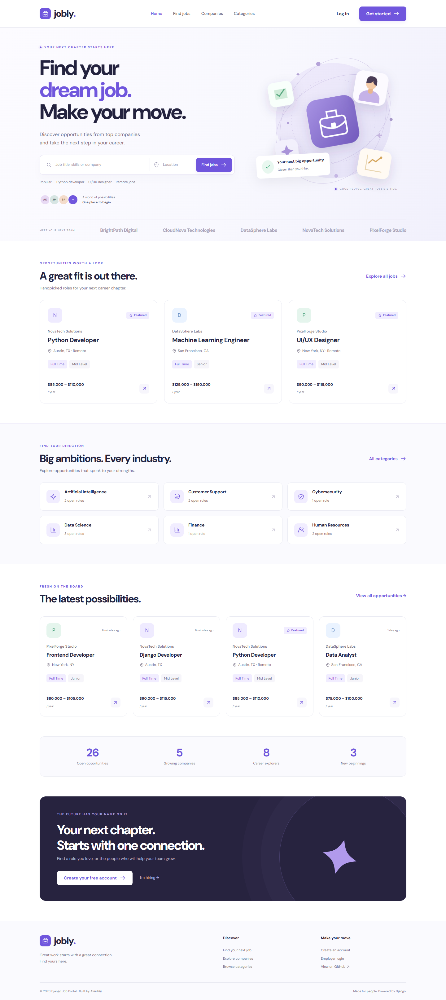
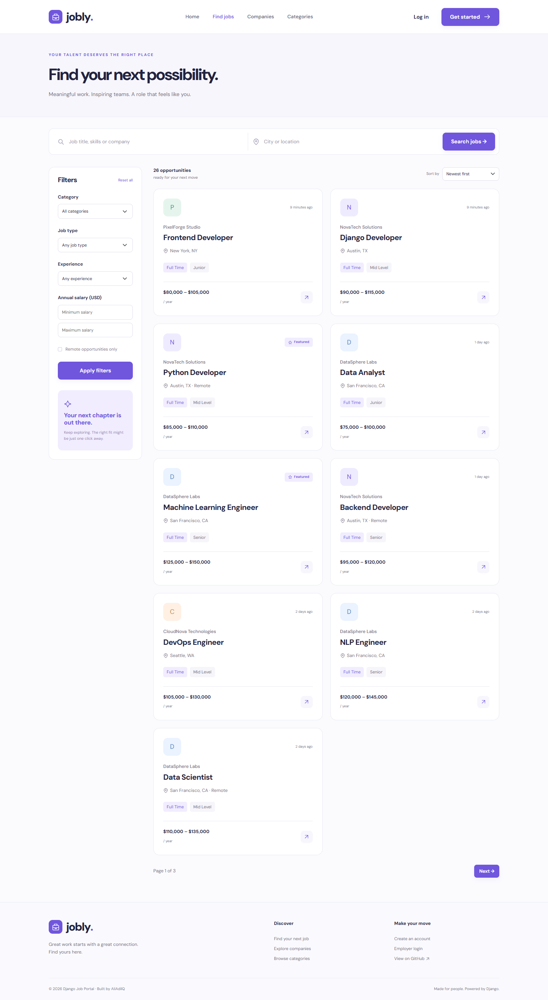
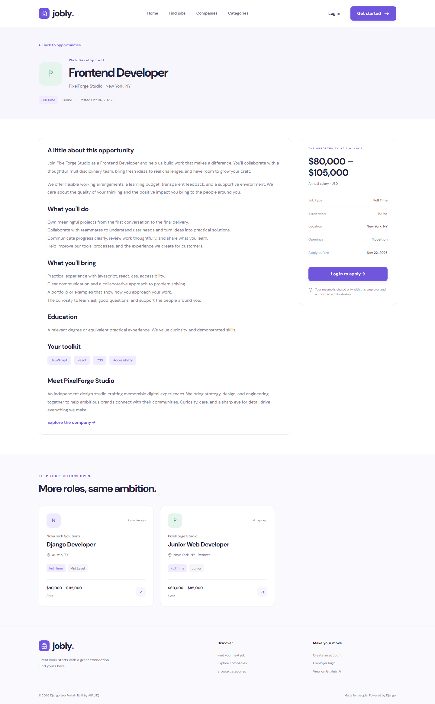
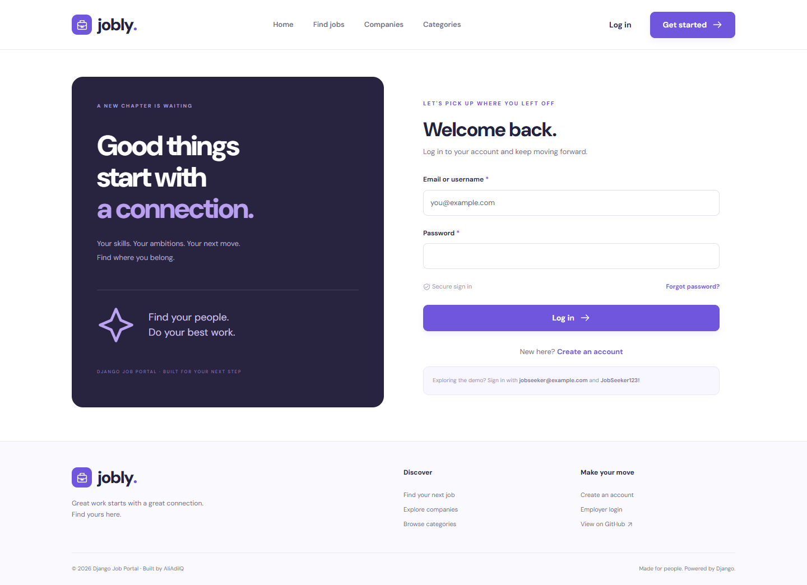
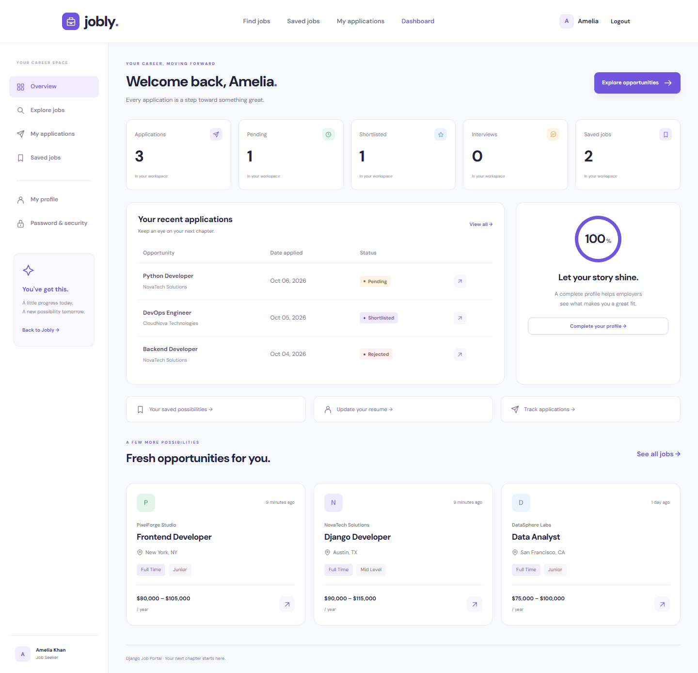
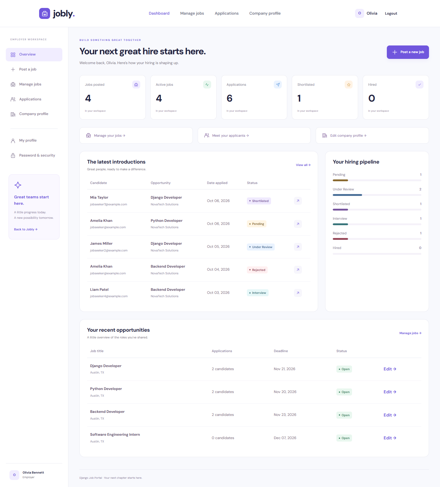
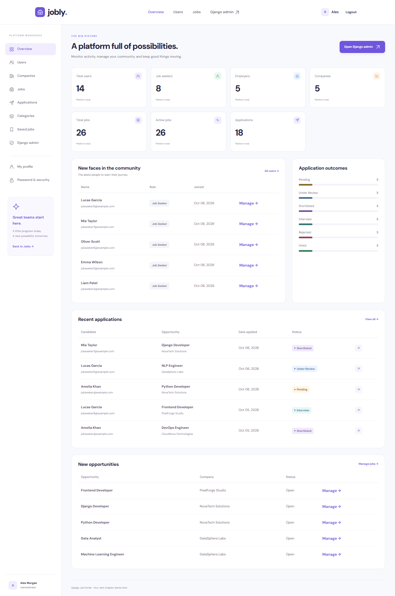
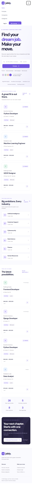
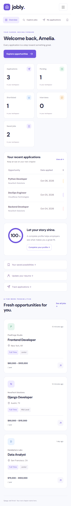

# Django Job Portal


**Great work starts with a great connection.**

A modern full-stack job portal built with Django, SQLite, Bootstrap and JavaScript, featuring role-based dashboards, job applications, employer management and admin controls. The interface is branded **Jobly**, with a consistent visual identity across the public website and every workspace.

## Overview

Django Job Portal connects job seekers with growing companies. Candidates discover roles, submit resumes, and follow their applications; employers manage opportunities and move candidates through a hiring pipeline. Administrators oversee the community through a custom dashboard and Django's built-in admin.

This portfolio project demonstrates Python and Django, authentication, role-based authorization, CRUD, SQLite, a responsive frontend, job application workflows, and admin dashboards. The code uses five focused apps, reusable templates, explicit permissions, and small forms and views that are approachable for beginners.

## Features

### Job Seeker Features

- Register with a job seeker account and sign in with email or username.
- Build a profile with a photo, skills, education, experience, location, bio, and PDF resume.
- Search by title, keyword, company, skills, and location.
- Filter by category, job type, experience, remote work, and overlapping salary ranges.
- Sort by date or salary and browse paginated results.
- Read detailed opportunities, company profiles, and similar jobs.
- Apply with a new PDF or a copy of the profile resume and a cover letter.
- Track Pending, Under Review, Shortlisted, Interview, Rejected, and Hired statuses.
- Save and remove bookmarks; view application statistics and profile completion.

### Employer Features

- Register as an employer and create a public company profile.
- Upload a logo and manage website, description, location, industry, and team size.
- Post, edit, delete, close, and reopen owned jobs.
- Specify salary, category, job type, experience, requirements, responsibilities, skills, education, remote options, deadline, and vacancies.
- Review received applications, filter by job or status, and read candidate profiles.
- Download submitted resumes securely and update application statuses.
- Monitor job counts, active roles, applications, shortlist, hires, and the hiring pipeline.

### Admin Features

- Staff-only custom dashboard with seven platform statistics and application outcome charts.
- Recent users, jobs, and applications, plus searchable management tables.
- Open the Django editor directly from custom tables to add, edit, or delete records.
- Full superuser management of users, roles, profiles, companies, jobs, categories, applications, and saved jobs.
- Configured Django Admin search, filters, ordering, and list displays.

### Across the Platform

- CSRF protection, hashed passwords, role checks, ownership checks, and server-side validation.
- POST-only logout, bookmark changes, and job status changes.
- Password change and token-based email password reset.
- PDF signature/size checks and verified JPG, PNG, or WebP uploads.
- Private resumes, copied application attachments, and database-enforced duplicate prevention.
- Local frontend assets, responsive navigation, dashboard sidebars, empty states, and styled error pages.

## Tech Stack

| Layer | Technology |
| --- | --- |
| Backend | Python 3.12+, Django 5.2 LTS |
| Frontend | HTML5, CSS3, Bootstrap 5.3.8, vanilla JavaScript |
| Database | SQLite3 |
| Images | Pillow |
| Configuration | python-dotenv |
| Typography & visuals | Locally hosted DM Sans, custom SVG icons and illustration |
| Testing | Django TestCase, optional Playwright browser verification |

Dashboard charts use CSS and live database counts. Bootstrap and DM Sans are checked into `static/vendor/` with their licenses; the website does not require a CDN or Node.js to run.

## Screenshots

These are real screenshots of the running application with seeded demo data.

### Home Page



### Job Listings



### Job Details



### Login



### Job Seeker Dashboard



### Employer Dashboard



### Admin Dashboard



<details>
<summary>Mobile screenshots</summary>





</details>

## Installation

Install **Python 3.12 or newer** and Git. Python 3.8 is too old for this project's Django version. SQLite is included with Python.

```bash
git clone https://github.com/AliAdilQ/django_job_portal.git
cd django_job_portal
python -m venv venv
```

Activate the virtual environment on **Windows**:

```bat
venv\Scripts\activate
```

In PowerShell, use `venv\Scripts\Activate.ps1`. If PowerShell blocks activation, you can use `venv\Scripts\python.exe` directly for the commands below.

On **Linux/macOS**:

```bash
source venv/bin/activate
```

Install dependencies:

```bash
pip install -r requirements.txt
```

Copy the environment file on Windows:

```bat
copy .env.example .env
```

Or in PowerShell:

```powershell
Copy-Item .env.example .env
```

On Linux/macOS:

```bash
cp .env.example .env
```

Initialize the database, load the demo, and start the application:

```bash
python manage.py migrate
python manage.py seed_data
python manage.py runserver
```

- Website: [http://127.0.0.1:8000/](http://127.0.0.1:8000/)
- Django Admin: [http://127.0.0.1:8000/admin/](http://127.0.0.1:8000/admin/)
- Custom Admin: [http://127.0.0.1:8000/dashboard/admin/](http://127.0.0.1:8000/dashboard/admin/)

If port 8000 is occupied, run `python manage.py runserver 127.0.0.1:8001` and use port 8001 in these URLs.

## Demo Accounts

Run `seed_data` before using these accounts.

| Role | Email / Username | Password |
| --- | --- | --- |
| Admin | admin / admin@example.com | Admin12345! |
| Employer | employer@example.com | Employer123! |
| Job Seeker | jobseeker@example.com | JobSeeker123! |

**Security note:** These credentials are intended for local demonstration only. Never use demo credentials in a production deployment.

Additional fictional employer accounts use `employer2@example.com` through `employer5@example.com` with `Employer123!`. Additional seekers use `jobseeker2@example.com` through `jobseeker8@example.com` with `JobSeeker123!`.

The command creates an administrator, 5 employers, 8 seekers, 5 companies, 12 categories, 26 jobs, 18 applications, and 16 bookmarks. Company logos, candidate photos, and valid fictional PDF resumes are generated locally.

## Project Structure

```text
django_job_portal/
├── django_job_portal/      # Settings, URL routing, WSGI and ASGI
├── accounts/              # Custom user, profiles, companies, auth and permissions
├── jobs/                  # Categories, jobs, search, CRUD and bookmarks
├── applications/          # Applications, statuses and private resume downloads
├── dashboard/             # Seeker, employer and staff workspaces
├── core/                  # Public pages, reusable helpers, tests and seed command
│   └── management/commands/seed_data.py
├── templates/
│   ├── base.html
│   ├── includes/          # Navbar, footer, forms, cards, alerts and pagination
│   ├── core/
│   ├── accounts/
│   ├── jobs/
│   ├── applications/
│   └── dashboard/
├── static/
│   ├── css/               # Site and dashboard styles
│   ├── js/                # Form accessibility and sorting behavior
│   ├── images/            # Custom SVG assets
│   └── vendor/            # Bootstrap, DM Sans and third-party licenses
├── screenshots/           # Actual desktop and mobile captures
├── scripts/               # Optional screenshot and asset maintenance tools
├── .github/               # CI workflow and issue templates
├── manage.py
├── requirements.txt
├── .env.example
├── .gitignore
├── CONTRIBUTING.md
├── LICENSE
└── README.md
```

`db.sqlite3` and `media/` are generated locally and deliberately ignored by Git. All database migrations and screenshot assets are included.

## Main Pages

| URL | Page / audience |
| --- | --- |
| `/` | Homepage, featured roles, recent jobs, categories and live statistics |
| `/jobs/` | Search, filters, sorting and pagination |
| `/jobs/<id>/` | Job detail and similar opportunities |
| `/companies/` | Company directory |
| `/companies/<id>/` | Company profile and open roles |
| `/categories/` | Browse by category |
| `/accounts/register/` | Choose job seeker or employer |
| `/accounts/login/` | Email or username login |
| `/accounts/profile/` | Authenticated personal profile |
| `/accounts/company/` | Employer company profile |
| `/accounts/password/change/` | Change password |
| `/accounts/password/reset/` | Request email password reset |
| `/dashboard/` | Redirect to the correct role dashboard |
| `/dashboard/seeker/` | Job seeker dashboard |
| `/dashboard/employer/` | Employer dashboard |
| `/dashboard/admin/` | Staff-only custom administration |
| `/dashboard/admin/<resource>/` | Staff management tables |
| `/jobs/new/` | Employer job creation |
| `/jobs/manage/` | Manage owned jobs |
| `/jobs/saved/` | Job seeker bookmarks |
| `/applications/mine/` | Own submitted applications |
| `/applications/received/` | Employer's received applications |
| `/applications/<id>/` | Authorized application detail and status update |
| `/admin/` | Django Admin |

Custom management resources are `users`, `companies`, `jobs`, `applications`, `categories`, and `saved-jobs`. Staff can see the custom workspace; Django Admin editing requires the appropriate model permissions. The demo superuser has full access.

## Database

The application uses **SQLite3 only**. `migrate` creates `db.sqlite3`; `seed_data` makes the demo reproducible from an empty database. Foreign keys, salary/vacancy checks, case-insensitive unique emails, unique bookmarks, and a unique applicant/job pair protect data integrity.

Profile photos and company logos are public. Resumes live in the private `media/resumes/` directory and are downloaded through authenticated, authorized views. Applications retain a snapshot of the submitted resume even when a candidate replaces their profile resume.

Salary values are annual USD; search salary bounds match jobs whose advertised salary range overlaps the requested range. Open jobs must have a future/current deadline and an active employer. Homepage and dashboard statistics reflect actual stored data.

## Seed Data

```bash
python manage.py seed_data
```

The command creates only missing demo records. Running it again preserves existing passwords, application statuses, and edited records, and does not continuously duplicate data. Conflicting pre-existing demo usernames are rejected. It refuses to run when `DEBUG=False`.

Application deadlines are relative to the date the jobs are first created. If an old demo expires, an employer or administrator can update its deadline before reopening it. All companies, profiles, websites, and resumes are fictional demonstration content.

## Testing

```bash
python manage.py check
python manage.py test
python manage.py makemigrations --check --dry-run
```

The suite covers 22 critical cases: registration, email login, employer onboarding, password flows, CSRF, role restrictions, owned job CRUD, validation, application creation, duplicate prevention, resume snapshots and privacy, secure administrator downloads, status changes, bookmarks, search, pagination, image uploads, administration, and repeated seeding.

Tests use a separate database and temporary upload directories. A fast password hasher is enabled only inside the tests. GitHub Actions runs the checks on Python 3.12 and 3.13.

### Regenerate Screenshots (Optional)

Node.js, Playwright, and a local Chrome installation are needed only for this optional step. With the seeded Django server running in another terminal:

```bash
npm install --no-save --package-lock=false playwright
node scripts/capture_screenshots.cjs
```

For a different port, set `PORTAL_URL` to its URL first. For example, in PowerShell:

```powershell
$env:PORTAL_URL = "http://127.0.0.1:8001"
node scripts/capture_screenshots.cjs
```

The script signs in to all three workspaces, visits major pages, verifies mobile overflow and navbar behavior, checks browser errors, and captures seven desktop and two mobile screenshots. It expects the original demo passwords.

## Configuration & Deployment

Local settings load `.env`, with development fallbacks if the file is missing. Password reset messages print to the server console by default. Set the SMTP variables in `.env.example` to deliver actual email.

For deployment, use a production WSGI/ASGI server, HTTPS, a durable SQLite file, and backups. Set `DEBUG=False`, a strong unique `SECRET_KEY` of at least 50 characters, `ALLOWED_HOSTS`, and `CSRF_TRUSTED_ORIGINS`. Production settings enable HTTPS redirects, secure cookies, HSTS, content-type protection, and clickjacking protection.

```bash
python manage.py collectstatic --noinput
python manage.py check --deploy
```

Serve `staticfiles/` from your web server. For media, expose **only** `media/photos/` and `media/logos/`. **Never serve all of `media/` publicly**: resume downloads must continue to go through Django. Development URL routing already follows this rule. Standard 404/500 pages appear with `DEBUG=False`; Django's diagnostic pages are shown during development.

This repository implements the application and local demo. Public hosting, SMTP delivery, login throttling, malware scanning, and operational monitoring are deployment work; the Django development server is for local use.

## Future Improvements

- REST API and a mobile client
- Application email notifications
- OAuth login
- Skills-based recommendations
- Resume parsing and richer candidate insights
- Employer team accounts and interview scheduling
- Production deployment and operational monitoring

## GitHub Publishing

For a new local repository, after creating `AliAdilQ/django_job_portal` on GitHub:

```bash
git init
git add .
git commit -m "Initial commit: Complete Django Job Portal"
git branch -M main
git remote add origin https://github.com/AliAdilQ/django_job_portal.git
git push -u origin main
```

If the repository or remote is already initialized, skip the corresponding initialization commands. GitHub authentication and repository write access are needed to push.

**Suggested repository description:** A modern full-stack job portal built with Django, SQLite, Bootstrap and JavaScript, featuring role-based dashboards, job applications, employer management and admin controls.

**Suggested topics:** `django`, `python`, `job-portal`, `web-development`, `sqlite`, `bootstrap`, `javascript`, `django-project`, `portfolio-project`, `full-stack`, `job-board`.

## Author

**AliAdilQ**

- GitHub: [https://github.com/AliAdilQ](https://github.com/AliAdilQ)
- Repository: [https://github.com/AliAdilQ/django_job_portal](https://github.com/AliAdilQ/django_job_portal)

## License

MIT License. See [LICENSE](LICENSE). Bundled third-party asset licenses are in [static/vendor](static/vendor).
